# Katofli

**A taskbar for Windows 11 that you arrange yourself.**

Katofli replaces the system taskbar with bars you arrange yourself: a task
strip, a launcher, status icons, a clock and many more modules, on any edge of
any display. Pick one of seven themes and it restyles the whole bar, its
pop-ups and Settings, down to shapes, type and motion. It installs for your
user account only, needs no administrator rights, and is free to use.

**[Download the latest version](https://github.com/lidatheo/katofli-releases/releases/latest)**

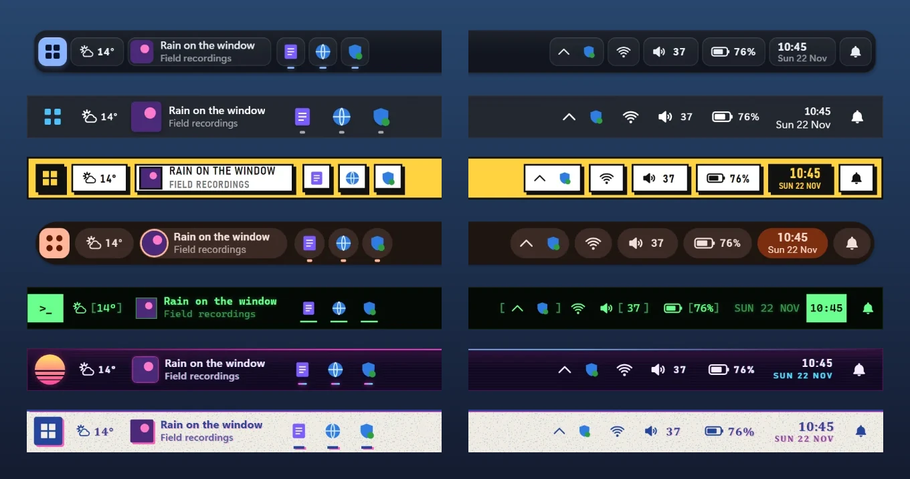

- **Seven themes**, each with several variants and a High Contrast one.
- **Up to four extra bars**, on any edge of any display.
- **14 languages** that switch without a restart.
- **For your account only:** no administrator rights.

Your taskbar is always one key away: **Ctrl+Alt+Win+K** quits Katofli and
gives the system taskbar back, even if the bar looks frozen.

## What it does

**Themes that restyle the whole bar.** Bento, Glasswork, Neo-Brutalist, Tonal,
Mono Terminal, CRT Vaporwave and Paper Risograph change shapes, type and motion
as well as colours, across the bar, pop-ups, flyouts and Settings.

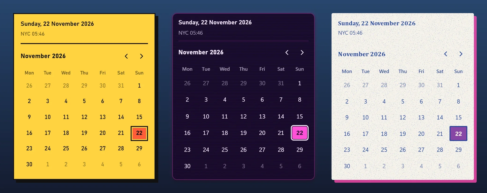

**A launcher in three layouts.** A menu, a full-screen grid or a search box
that finds apps, files and settings even when you mistype, with sums, a run
box and your own web searches.

**A game bar.** One library from the game stores on your PC and your own
folders, play time counted on this PC, companion tools that start with a game,
and four layouts.

  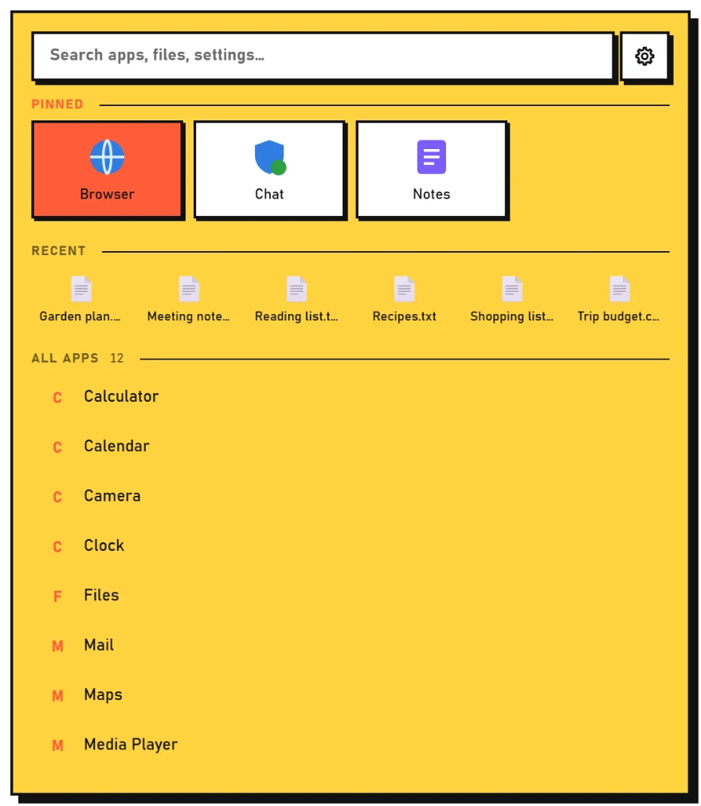
  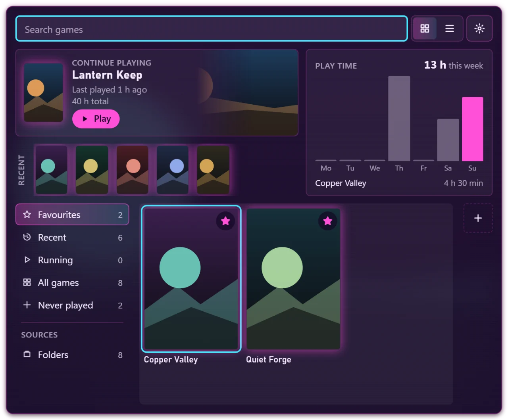

### More of Katofli

<table>
<tr>
<td width="50%">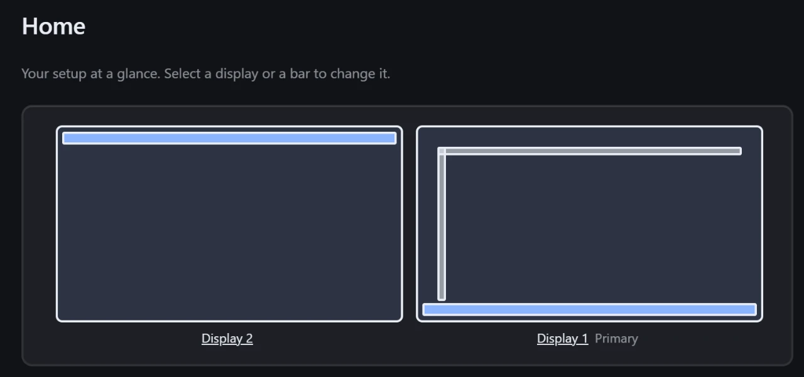 <b>Several bars, a layout per display.</b> Up to four extra bars on any edge of any display.</td>
<td width="50%">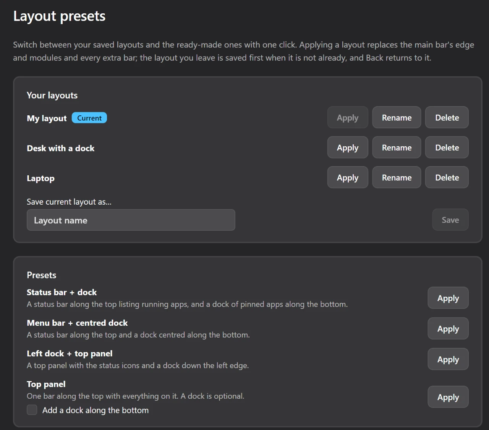 <b>Layouts you switch in one step.</b> Four presets and up to 12 saved layouts, with a way back to the one you left.</td>
</tr>
<tr>
<td>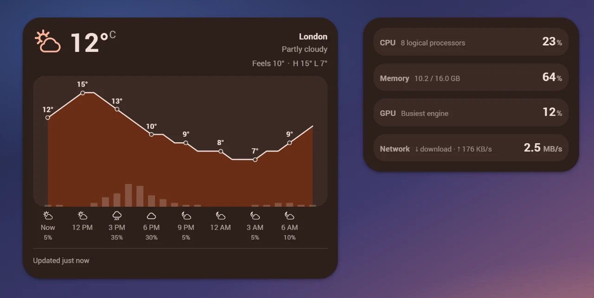 <b>Desktop widgets (experimental).</b> Weather, meters, what is playing and the game bar home as cards on your wallpaper.</td>
<td>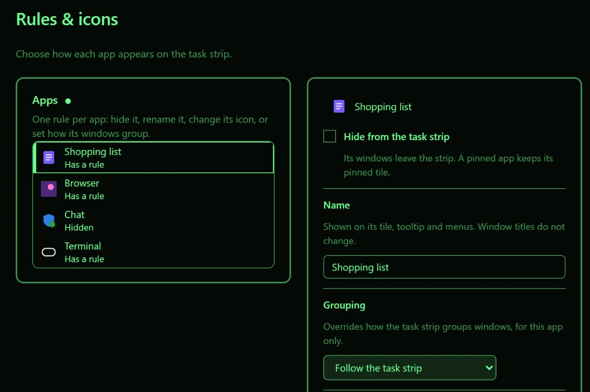 <b>Per-app rules.</b> Hide, rename, re-icon or regroup an app, or open it on a chosen display or desktop.</td>
</tr>
<tr>
<td>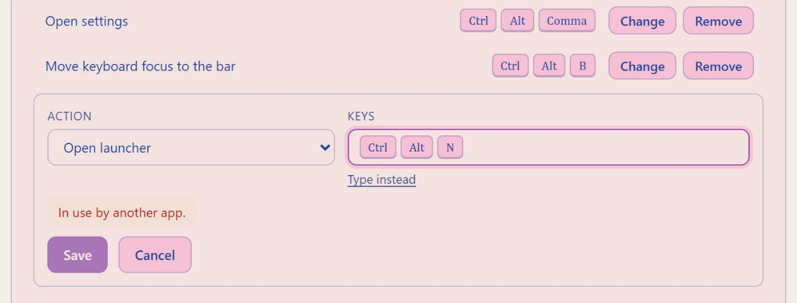 <b>Keyboard control.</b> Global shortcuts with conflict detection, and a keyboard mode for the whole bar.</td>
<td>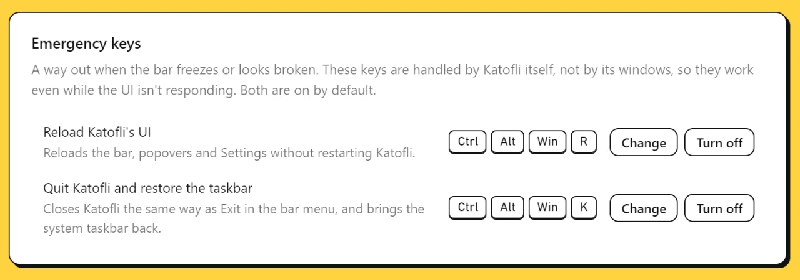 <b>Recovery you can count on.</b> Emergency keys, a watchdog after a crash, and a safe start.</td>
</tr>
<tr>
<td>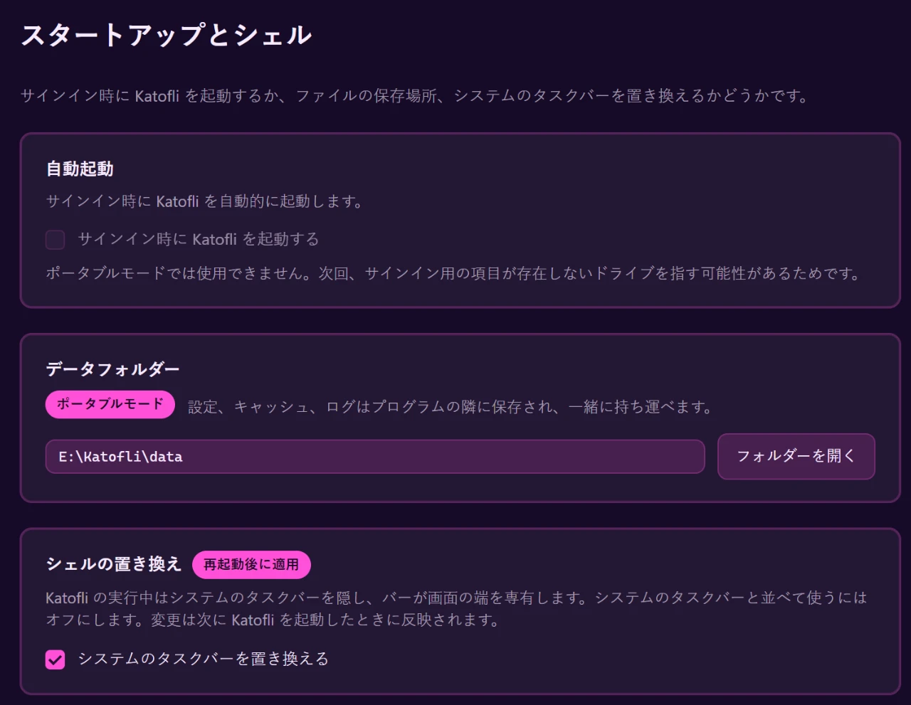 <b>Portable mode and 14 languages.</b> Run it from a folder or a USB stick, in your language.</td>
<td>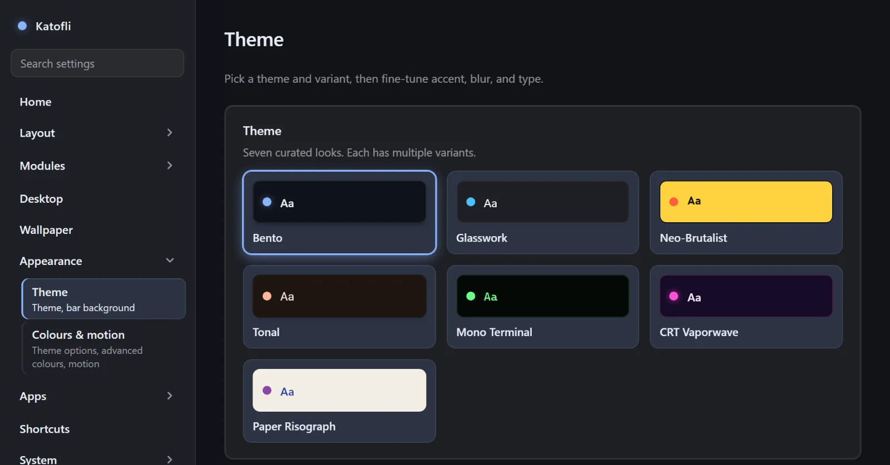 <b>Settings that show you the result.</b> Pick a theme and its variant and see the bar change as you go.</td>
</tr>
</table>

Also on board: clock, calendar, volume, network, battery, media, weather, meters and clipboard history modules.

**Private by design.** Katofli has no telemetry, no crash reports and no
account. Nothing is sent to the developer.

## Download and install

Katofli runs on Windows 11, 64-bit. Each release on the
[Releases](https://github.com/lidatheo/katofli-releases/releases) page has two
downloads:

- **`Katofli_<version>_x64-setup.exe`**, the setup. The right choice for most
  people. Installed copies check for a new version once a day and ask before
  installing it.
- **`Katofli_<version>_x64-portable.zip`**, the portable copy. Unzip it
  anywhere you can write to and run `katofli.exe`; its settings stay in that
  folder.

Katofli is in beta and not code-signed yet, so the system may show "Windows
protected your PC" the first time you run the setup. Choose **More info**,
then **Run anyway**. Run the setup as your normal user, not as administrator.

## Getting your taskbar back

Katofli hands the system taskbar back whenever it exits.

- Press **Ctrl+Alt+Win+K**, the emergency quit key, even when the bar looks
  frozen.
- Or right-click the bar and choose **Exit Katofli (restore the system
  taskbar)**.
- After a crash, a small helper process puts the taskbar back by itself.
- Still stuck? Run `katofli.exe --restore-shell` from the folder Katofli is
  installed in (`%LOCALAPPDATA%\Katofli`, or the portable copy's folder).

## Report a problem or suggest something

[Open an issue](https://github.com/lidatheo/katofli-releases/issues/new/choose)
and pick a form: a bug, an idea or a translation fix. This is also where the
"Suggest a translation fix" link in Katofli's Settings takes you.

Please say which version you use (Settings > System > About), what you did,
what you expected and what happened. Look through any log file before you
attach it: it can contain device names and web addresses.

## Security

To report a security problem, please do not open a public issue. Use "Report a
vulnerability" on the [Security](https://github.com/lidatheo/katofli-releases/security)
tab of this repository. See [SECURITY.md](SECURITY.md).

---

This repository holds the downloads and the issue tracker; the source code is
not published here. The screenshots are renders of Katofli's interface with
sample data.
